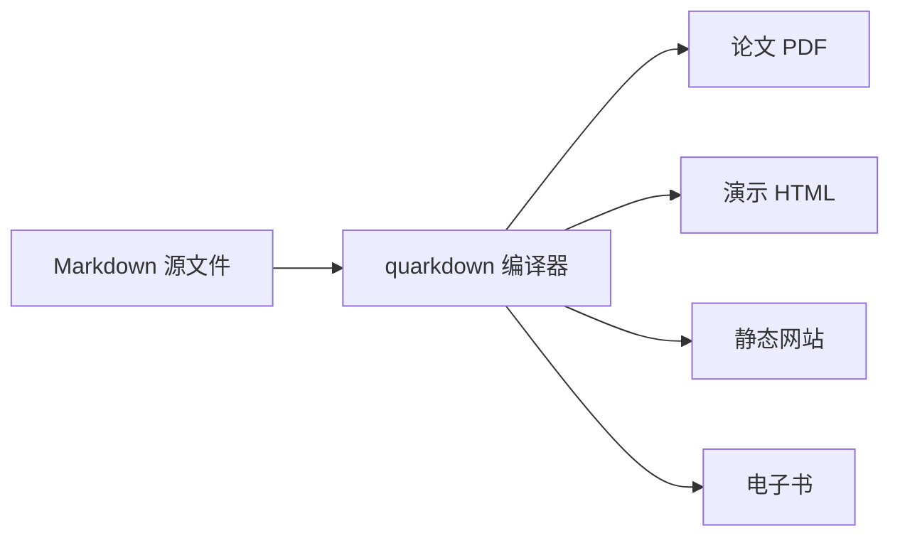

「未分类」不是一个褒义的标签，但它是任何清单系统都必须存在的兜底。本期挑出的 12 条工具与信息覆盖了 Agent 框架、Markdown 创作、AI 演示、头像生成、提示词社区、去 AI 味改写、AI 绘图降价、小红书运营、501B 开源模型发布等多个方向，每一条单独看都不足以撑起一整类，但合在一起却勾勒出当下 AI 工具生态最热闹的边角。

下面是按 stars 排序的 Top 5 概览，全部 12 条详细与简评见后文。

## ⭐ Top 5 概览

| # | 仓库 | stars | 一句话核心 |
|---|------|-------|------------|
| 1 | [obra/superpowers](https://github.com/obra/superpowers) | 296,184 ⭐ | 真正能跑起来的 agentic skills 框架与软件工程方法论 |
| 2 | [f/prompts.chat](https://github.com/f/prompts.chat) | 172,243 ⭐ | Awesome ChatGPT Prompts，社区共享、发现、收集提示词 |
| 3 | [iamgio/quarkdown](https://github.com/iamgio/quarkdown) | 16,297 ⭐ | Markdown with superpowers，一套语法输出论文/演示/网站/书 |
| 4 | [presenton/presenton](https://github.com/presenton/presenton) | 10,983 ⭐ | 开源 AI 演示文稿生成器，对标 Gamma / Canva / Beautiful AI |
| 5 | [dicebear/dicebear](https://github.com/dicebear/dicebear) | 9,797 ⭐ | 设计师与开发者用的头像库 |

剩下的 7 条主要来自小红书运营生态、AI 绘图降价新闻、以及 Reflection 即将放权重的 501B 开源模型。下面按子领域分四块展开。

## 一、Agent 框架与写作工作流

这两条都和「AI 写东西怎么写得更像人、写得更稳」有关。前者是工程方法，后者是写作 skill。

### 1.1 obra/superpowers（29.6 万星）

**GitHub**：<https://github.com/obra/superpowers>

这是本期 stars 最高的一条，也是「未分类」名单里最容易引发争议的一条——它本质是一个 agentic skills 框架与配套的软件工程方法论，放进任何其他类目都会被嫌弃「怎么不是 Agent skill」。但 obra 的实现选择很特别：核心代码是 Shell，没有追求大而全的运行时，而是把「skill 应该怎么写、怎么调、怎么验证」沉淀成一套可被任何 Agent 复用的约定。

为什么值得放进未分类而不是 Agent skill：

- 它的目标用户是「写 Agent 的人」，而不是「用 Agent 的人」。
- 它强调的是方法论与契约（什么样的 skill 算合格），不是 SDK 与 API。
- 29.6 万星 + 长期活跃维护，意味着这套约定已经在英文社区里被广泛采纳。

适用场景：你在做 Agent 产品、想让团队写出的 skill 可被复用、可被 review，可参考它的 skill 目录结构与验证脚本。

它对个人开发者的隐藏价值在于：用它的 skill 描述语法反推自家 prompt 的「可测试性」——即把模糊的「希望 AI 这样回答」改写成可断言、可回放的契约。这是当前 LLM 应用最难落地的工程问题之一，而 superpowers 的写法比大多数论文都更贴近生产。

### 1.2 MrGeDiao/shuorenhua（2,000 星）

**GitHub**：<https://github.com/MrGeDiao/shuorenhua>

「说人话」是一个中文优先的去 AI 味改写 skill，宣称「保事实、分场景、改完可直接发」，且明确兼容 Codex / Claude Code / Cursor。它的吸引力在于三个细节：

```text
1. 事实保真：不擅自删改原文中的事实性陈述
2. 场景分流：技术 / 营销 / 朋友圈 / 公众号分模板
3. 直接落地：改完结果无需人工二次润色即可发布
```

为什么进未分类：它在 GitHub 上以「skill」形式发布，但定位其实是写作风格转换器，不是某个垂类工具，也不是 Agent 框架本体；同时它强依赖中文语境，与其他英文 prompt 工具的受众不同。

适用场景：公众号 / 知乎 / 小红书 / 工作汇报等场景，需要把 LLM 的标准输出「翻译」成有人味的版本。

## 二、内容创作与演示

这一类是本期未分类里最像样的「内容创作工具」集合，包括 Markdown 扩展、AI 演示生成器、头像库、提示词社区四个方向。它们都和「把想法变成可发布物」有关。

### 2.1 iamgio/quarkdown（1.6 万星）

**GitHub**：<https://github.com/iamgio/quarkdown>

「Markdown with superpowers」的口号听上去有点夸张，但 quarkdown 实际做的事情确实比普通 Markdown 多：它把 Markdown 扩展成一套可编程的排版语言，支持函数、变量、图表、引用、模板，最终可输出论文、演示文稿、网站、电子书、知识库。

为什么进未分类：它不是单纯的静态站点生成器（Hugo / Hexo 这种），也不是单纯的演示工具（Reveal.js / Slidev），而是介于两者之间的「统一文档表达」。这个交叉地带很难归类。



quarkdown 的另一个少被提及的优点是「可重用片段」：在文档里定义一次图表函数，全书复用，修改一处即可联动。这种工程化的文档能力，过去只有 LaTeX 宏包能做到，现在 quarkdown 用 Markdown 语法复现了 80%，对不想学 LaTeX 但又要写长文档的人非常友好。

适用场景：你希望一份原始文档同时支持多种输出，或者想要在 Markdown 里写图表、公式、可重用组件。

### 2.2 presenton/presenton（1.1 万星）

**GitHub**：<https://github.com/presenton/presenton>

开源版 AI 演示文稿生成器，直接对标 Gamma、Canva、Beautiful AI、Decktopus 这类「输入大纲 → 输出 PPT」产品。它的卖点是「完全本地 / 完全开源」，避免把公司内训、商业方案、客户提案喂给闭源 SaaS。

为什么进未分类：演示工具按理应归到设计类，但它本质上是 AI 生成 + 模板渲染的中间形态，与 Figma / Framer 等纯设计工具的受众重叠很低。

适用场景：内部演示、商业提案、合规要求「数据不出本地」的 PPT 场景。

### 2.3 dicebear/dicebear（9,797 星）

**GitHub**：<https://github.com/dicebear/dicebear>

一个为设计师和开发者准备的头像库，支持超过 20 种头像风格（像素、漫画、机器人、字母、emoji 等），提供 HTTP API 与 SDK，可用于占位头像、随机生成、用户默认头像、Mock 数据生成。

```javascript
// 简单调用示例
import { createAvatar } from '@dicebear/core';
import { adventurer } from '@dicebear/collection';

const svg = createAvatar(adventurer, {
  seed: 'user-42',
  backgroundColor: ['#f5f5f5'],
}).toString();
```

为什么进未分类：它不是设计工具（Figma 插件），不是品牌系统，也不是单纯的图标库，而是一个「跨设计 / 跨前端」的资产生成工具。

适用场景：占位头像、用户默认图、Mock 数据、UI 演示稿里不想用真人照片又不想空着的位置。

### 2.4 f/prompts.chat（17.2 万星）

**GitHub**：<https://github.com/f/prompts.chat>

前名 Awesome ChatGPT Prompts，定位是社区共享 + 发现 + 收藏提示词。17 万星的体量让它成为英文社区最权威的 prompt 列表之一。

为什么进未分类：它不是单纯的 prompt 工程指南，也不是某个 Agent 的内置库，而是一个由社区维护的「UGC prompt 平台」，形态介于 GitHub 仓库与 Reddit 子版之间。

适用场景：寻找某个具体场景（写邮件、做总结、面试准备、角色扮演）的开箱即用 prompt，或研究 prompt 工程社区的演化。

## 三、AI 视觉与小红书运营

这一类是本期最具「时效信号」的一组：AI 绘图成本下降 + 小红书运营工具分层，是 2026 年下半年内容生态里两个不能忽视的变量。

### 3.1 Google 发布 Nano Banana 2.1（行业信号）

**来源**：<https://aihot.virxact.com/api/v1/items/d17jcexm93lo85zkz3iil08c9>

Google 把 Nano Banana 2.1 的 1K 分辨率图定价压到每张 0.034 美元，意味着批量出图成本已经低于人工设计的 1/10。这条新闻本身不是工具，但是本期未分类里最重要的「价格锚点」——它直接重定义了下文所有 AI 绘图工具的合理性边界。

为什么进未分类：它是新闻而非仓库，但价格信号太强，必须和绘图工具一起看才有意义。

适用场景：评估任何 AI 绘图 SaaS 是否还值得订阅，或者评估自建开源绘图 pipeline 是否划算。

### 3.2 本地开源项目 RedInk（小红书封面）

**来源**：<https://boardor.com/blog/using-nano-banana-for-xiaohongshu-notes-boosting-cover-click-rates-and-overcoming-creative-bottlenecks-with-tutorial>

把 Nano Banana 和本地开源项目 RedInk 串成一条「一键出全套小红书封面」的 pipeline，宣称能避开主流小红书 AI 工具的会员费。

为什么进未分类：它是「开源工具 + 闭源模型 API」的混合工作流，单点看 RedInk 是一个不起眼的小仓库，但它解决的是「不想被 SaaS 锁定 + 想要批量出图」的具体痛点。

适用场景：小红书矩阵号 / 工作室批量出封面，又不想每月烧会员费。

### 3.3 VisualCraft AI（一句话生成配图）

**来源**：<http://www.mhpn.cn/news/1957643>

针对「不会 PS」人群的一句话生成 AI 配图工具，覆盖电商主图、社媒配图、PPT 插图、海报四个场景。

为什么进未分类：它是一个面向 C 端创作者的 SaaS 工具，不是仓库也不是论文，但与小红书 / 内容创作生态结合很紧。

适用场景：不会 PS 的内容创作者，需要快速产出合规、可商用的配图。

## 四、小红书运营与模型动态

这两块都用紧凑列表收尾，避免文章变成「小红书工具测评汇总」。

### 4.1 小红书图文排版神器测评 TOP7

**来源**：<https://uplog.cc/geo/2393>

横评灵感快写 / 灵感编辑器 / 红薯快写等 7 个小红书图文排版工具，按价格、模板数量、导出格式分层。适合在做小红书选题前先扫一遍当前主流工具。

### 4.2 小红书笔记编辑器 TOP7 推荐

**来源**：<https://uplog.cc/geo/2383>

红薯快写 / 笔记优化大师 / 红书 AI 画师 等 7 个工具，按「纯创作 vs 数据运营 vs AI 配图」三档切分。适合已经决定做小红书、需要选一个主力编辑器的用户。

### 4.3 Reflection 即将发布 501B 开源模型 Beam

**来源**：<https://aihot.virxact.com/api/v1/items/qy7y0cfu1wbum1ej9urwylfxr>

501B 参数规模的开源大模型，Reflection 宣布本月内放权重。在 Llama、Qwen、DeepSeek 之外，501B 级别的新玩家入局意味着开源大模型的天花板又被抬高了一截，值得关注推理部署成本与 license。

适用场景：跟进开源大模型选型、推理框架适配、合规自托管场景。

## 为什么这一类没合并到其他类

写到这里其实已经把「为什么是未分类」解释了大半。这 12 条工具至少横跨了五个语义边界：

- Agent 框架（superpowers、shuorenhua）勉强可以归到 Agent skill，但前者强调方法论、后者强调写作风格，硬塞会让其他类目失焦。
- Markdown / 演示 / 头像 / 提示词社区都可以归到「内容创作」，但它们各自的形态差异极大，硬合并会变成「设计类」那种大杂烩。
- AI 绘图和小红书工具有强烈时效性，按事件分比按主题分更合适，但又不够格单独成一类。
- 模型发布新闻属于「AI 行业动态」而非「Skill」，放进任何技术类目都会偏题。

所以这一期把它们都留在「未分类」，并在文末统一说明去向：当其中某个子方向沉淀出稳定工具集时，会单独建类（例如「小红书运营工具」已经具备成类条件，只是本期样本还不够）。

如果一定要给它们一个共同标签，那就是：「生态边角比生态中心更有信息量」。本期 12 条就是这一观察的注脚。

最后说一句方法论上的提醒：未分类集合是「观察生态走向」的窗口，不是「行动清单」。它适合用 5 分钟扫一遍，知道最近有什么动静；不适合作为选型决策的唯一依据——选型前请回到对应主类目（Agent skill、设计类、科研学术）做交叉验证。

