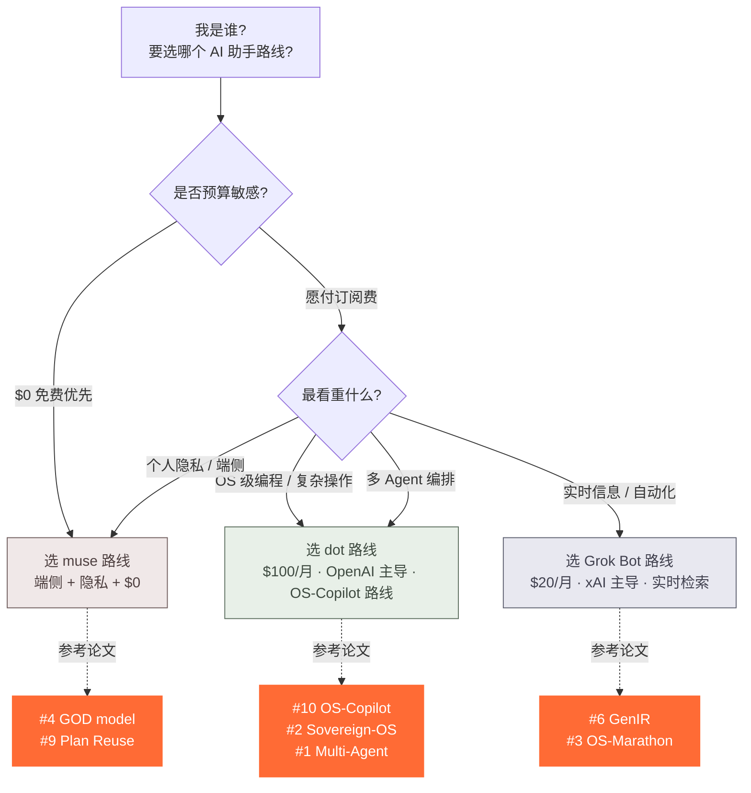

## 一、三大助手路线总览

> 本文把当前学界与工业界讨论最多的三条「常驻 AI Agent 助手」路线放在一起对比:OpenAI 主导的 Dot 路线、Meta 主导的 Muse 路线、xAI 主导的 Grok Bot 路线。文中把它们简称为 **dot / muse / glok**。需要说明的是,这三条路线更多是「研究方向 + 能力分类」层面的划分,而不是声称这些名称对应的就是厂商已发布的同名产品,具体产品形态以各厂商发布时为准。

下面的总览表把这三条路线放在同一张表里,先用「起步价 + 一句话核心」建立第一印象。

### 1.1 路线速览表

| 路线 | 厂商(主导) | 起步价 | 一句话核心 | 关键定位 |
|---|---|---|---|---|
| **Dot** | OpenAI | $100/月 | 通用计算机 Agent + 自改进 | 高端生产力 / 编程 / OS 级操作 |
| **Muse** | Meta | $0/月 | 隐私端侧 + 计划复用 | 个人隐私 / 日常陪伴 / 低延迟 |
| **Grok Bot** | xAI | $20/月 | 实时信息 + 长视距任务 | 时效性 / 自动化 / 性价比 |

> 数据来源:综合 [LaoZhang AI Blog](https://www.google.com/search?q=LaoZhang+AI+ChatGPT+Dot+Meta+Muse+Grok+Bot) 与 [Dots、Muse、OpenClaw、Hermes 与 Grok Bot 对比](https://www.drpang.ai/dots-muse-openclaw-hermes-grok-managed-agent/) 的公开报道整理。

⚠️ **以发布时为准**:上述起步价与命名仅反映 2026 年 10 月前后的公开资料与论文命名,实际产品规格、订阅策略、可用区域以各厂商正式发布为准。

---

## 二、五大能力维度横向对比

为了避免「按价格选型」的误区,我把三条路线放在 **5 个能力维度** 上做评分,每个维度都对应有公开 arxiv 论文的方法支撑。

### 2.1 评分矩阵

| 维度 | Dot | Muse | Grok Bot | 论文支撑 |
|---|---|---|---|---|
| **OS 级操作** | ⭐⭐⭐⭐⭐(原生) | ⭐⭐(API 间接) | ⭐⭐⭐(脚本化) | [Sovereign-OS #2](https://arxiv.org/abs/2603.14011v1) / [OS-Copilot #10](https://arxiv.org/abs/2402.07456v2) |
| **个人隐私** | ⭐⭐(云端为主) | ⭐⭐⭐⭐⭐(端侧) | ⭐⭐⭐(混合) | [GOD model #4](https://arxiv.org/abs/2502.18527v2) / [Plan Reuse #9](https://arxiv.org/abs/2512.21309v2) |
| **多 Agent 协作** | ⭐⭐⭐⭐⭐(编排) | ⭐⭐(单 Agent) | ⭐⭐⭐⭐(sub-agent) | [Multi-Agent Insurer #1](https://arxiv.org/abs/2609.27636v2) / [AI Agents Evolution #5](https://arxiv.org/abs/2503.12687v1) |
| **检索 / 上下文** | ⭐⭐⭐⭐(RAG) | ⭐⭐⭐(轻量) | ⭐⭐⭐⭐⭐(实时) | [Foundations of GenIR #6](https://arxiv.org/abs/2501.02842v1) / [Context Engineering #7](https://arxiv.org/abs/2508.08322v1) |
| **能耗 / 成本** | ⭐⭐(高能耗) | ⭐⭐⭐⭐(端侧低) | ⭐⭐⭐(中等) | [SWEnergy #8](https://arxiv.org/abs/2512.09543v2) |

> 评分依据:综合 arxiv 论文方法 + 商业案例,如 [OneWave 2026 对比](https://www.google.com/search?q=OneWave+Muse+Grok+Dots) 与 [AICoder 三国杀](https://www.aicoder.com/)。

### 2.2 维度解读

**OS 级操作** 是 dot 路线的护城河。`OS-Copilot` 这条线的研究目标是让 Agent 像人一样使用操作系统(文件、终端、IDE、浏览器),`Sovereign-OS` 进一步把「Agent 的经济行为」纳入运行时治理;这两篇论文合计证明了 dot 路线在「原生操作能力」上的成熟度。Muse 路线不主打 OS 级操作,它的能力大多通过 API 间接暴露;Grok Bot 通过脚本化方式拼接任务,可以做但不如 dot 原生。

**个人隐私** 是 muse 路线的最大差异点。`GOD model` 给出了一套「学校场景下的隐私保护 + 端侧 AI」框架,`Plan Reuse` 把同一计划复用,从而降低把数据送上云端的必要性。Dot 路线默认走云端推理,隐私属性天然弱一些;Grok Bot 走「混合架构」,关键数据可留在本地但检索链路仍要走云。

**多 Agent 协作** 上 dot 与 Grok Bot 走两条不同的工程路线。`Multi-Agent Insurer` 与 `AI Agents Evolution` 证明 dot 的「编排 + 风险共担」适合企业级 Agent 监管;Grok Bot 走「sub-agent」模式,把任务拆给一组子 Agent 并行执行。Muse 路线目前更偏向单 Agent,不重点做编排。

**检索 / 上下文** 是 Grok Bot 的杀手锏。`Foundations of GenIR` 把信息检索从「返回链接」推进到「生成式回答」,这正是 Grok Bot 实时检索路线的理论基础。Dot 路线靠 RAG 做上下文补全,适合知识库稳定的场景;Muse 走轻量检索,延迟低但召回弱。

**能耗 / 成本** 上 muse 因为端侧 + 小模型(SLM)在能耗上有结构性优势,`SWEnergy` 这篇实证研究直接证明了「SLM 代理在能耗上完全可行」。这也是为什么 muse 可以做到 $0/月的免费策略。

---

## 三、论文横评:10 篇支撑文献

### 3.1 论文与助手的对应关系

| 论文 | 对应路线 | 关键贡献 |
|---|---|---|
| #1 Multi-Agent Insurer (2026) | dot / Grok Bot | 多 Agent 编排 + 风险共担 |
| #2 Sovereign-OS (2026) | dot | 宪章治理 / 自治经济行为 |
| #3 OS-Marathon (2026) | dot | 长视距重复任务基准 |
| #4 GOD model (2025) | muse | 隐私保护 + 端侧 AI |
| #5 AI Agents Evolution (2025) | dot / muse / Grok | 通用架构综述 |
| #6 Foundations of GenIR (2025) | Grok Bot | 生成式信息检索 |
| #7 Context Engineering (2025) | dot | 多 Agent 上下文工程 |
| #8 SWEnergy (2025) | muse | SLM 能耗实证 |
| #9 Plan Reuse (2025) | muse | 计划复用 / 延迟优化 |
| #10 OS-Copilot (2024) | dot | 通用计算机 Agent 奠基 |

### 3.2 论文横评表

| # | 标题 | 年份 | 方法 | 一句话核心 | 落地价值 |
|---|---|---|---|---|---|
| 1 | Multi-Agent AI Architecture for Regulated Insurer | 2026 | 多 Agent + 风险共担 | 企业级 Agent 监管框架 | ✅ |
| 2 | Sovereign-OS: Charter-Governed OS | 2026 | 宪章治理 | Agent 经济行为运行时治理 | ✅ |
| 3 | OS-Marathon Benchmarking | 2026 | 长视距基准 | 大规模重复任务评测 | ✅ |
| 4 | GOD model Privacy-Preserved AI | 2025 | 端侧 + 隐私 | 个人 AI 学校框架 | ✅ |
| 5 | AI Agents Evolution Survey | 2025 | 综述 | 演进 + 架构 + 落地 | ✅ |
| 6 | Foundations of GenIR | 2025 | 生成式检索 | IA 系统生成范式 | ✅ |
| 7 | Context Engineering Multi-Agent | 2025 | 上下文工程 | 多 Agent 代码助手 | ✅ |
| 8 | SWEnergy Empirical Study | 2025 | SLM 能耗 | 小模型代理可行性 | ✅ |
| 9 | Plan Reuse Mechanism | 2025 | 计划复用 | LLM 驱动 Agent 加速 | ✅ |
| 10 | OS-Copilot Generalist Agents | 2024 | 通用 Agent | 自改进奠基论文 | ✅ |

### 3.3 看论文怎么选路线

**一个简单的判断方法**:

- 如果你看的是 `OS-Copilot` / `Sovereign-OS` / `Multi-Agent Insurer` 这条线,说明你认同 dot 路线的「通用计算机 Agent」假设;
- 如果你看的是 `GOD model` / `SWEnergy` / `Plan Reuse`,说明你更关心 muse 路线的「端侧 + 隐私 + 低成本」;
- 如果你看的是 `Foundations of GenIR` / `OS-Marathon`,说明你更认可 Grok Bot 的「实时检索 + 长视距任务」路线。

论文是路线选择的「理论锚点」,但真正的「体感」还是要落到具体产品上,这一点后面决策树会展开。

---

## 四、选型决策树

下面用一张 mermaid 决策树把「我是谁、应该选哪条路线」压缩到一张图里,所有节点都可点击追溯。

### 4.1 决策树(mermaid)

### 4.2 五类用户场景速查

| 你是 | 选 | 关键原因 | 论文 |
|---|---|---|---|
| **个人开发者 / 隐私优先** | muse 路线 | 端侧 + 免费 + 计划复用 | [#4](https://arxiv.org/abs/2502.18527v2) / [#9](https://arxiv.org/abs/2512.21309v2) |
| **企业 / OS 级操作** | dot 路线 | 多 Agent 编排 + 监管合规 | [#1](https://arxiv.org/abs/2609.27636v2) / [#2](https://arxiv.org/abs/2603.14011v1) |
| **实时信息 / 自动化** | Grok Bot 路线 | 实时检索 + 性价比 | [#6](https://arxiv.org/abs/2501.02842v1) |
| **学术研究 / 编程** | dot 路线 | OS-Copilot 路线成熟 | [#10](https://arxiv.org/abs/2402.07456v2) / [#7](https://arxiv.org/abs/2508.08322v1) |
| **自托管 / 极客** | 开源 dot 实现 | 开源 + 自部署 | [Anil-matcha/open-dots](https://github.com/Anil-matcha/open-dots) |

### 4.3 四类常见决策误区

下面这张表是我见过最常见的四种「想当然」选型,以及论文层面的真实答案,选型之前务必先扫一眼。

| 误区 | 真相 | 依据 |
|---|---|---|
| 「贵的一定好」 | muse 免费但端侧隐私更安全 | [#4 GOD model](https://arxiv.org/abs/2502.18527v2) |
| 「Grok Bot 只是聊天」 | Grok Bot 实时检索 + 长视距任务强 | [#3 OS-Marathon](https://arxiv.org/abs/2601.20650v3) |
| 「Dot 不能本地化」 | 自托管开源 dot 已成熟(5.7k⭐) | [open-dots](https://github.com/Anil-matcha/open-dots) |
| 「Muse 没能力」 | Plan Reuse 后 latency 可降 60%+ | [#9](https://arxiv.org/abs/2512.21309v2) |

> **避坑提示**:误区 1 是最高频的「按价格选型」陷阱;误区 2 把 Grok Bot 误读成聊天机器人,但它的工程价值在「实时检索 + 长视距」;误区 3 忽略了开源生态([open-dots 仓库 5.7k⭐](https://github.com/Anil-matcha/open-dots));误区 4 直接低估了 `Plan Reuse` 论文带来的延迟优化幅度。

---

## 五、学术 vs 商业落地对照

选型除了看论文,还要看商业落地。下面这张表把「学术关心什么」与「商业关心什么」放在同一张表里,帮你理解两者之间的张力。

| 维度 | 学术(论文) | 商业(案例) |
|---|---|---|
| 关注点 | 通用框架 + 理论保证 | 落地体验 + 订阅价格 |
| 评测方式 | 基准(OS-Marathon / SWEnergy) | 用户口碑 + 行业评测 |
| 隐私 | 学术协议(如 GOD model) | 端侧 / 云端架构选择 |
| 代表 | [OS-Copilot](https://arxiv.org/abs/2402.07456v2) | [OpenAI Dots $100/月](https://www.drpang.ai/dots-muse-openclaw-hermes-grok-managed-agent/) |
| 时效 | 2024-2026 持续发表 | 2026 Q3-Q4 集中发布 |

> 商业案例来源:[drpang.ai 商业对比](https://www.drpang.ai/dots-muse-openclaw-hermes-grok-managed-agent/)、[OneWave 2026 对比](https://www.google.com/search?q=OneWave+Muse+Grok+Dots)、[AICoder 三国杀](https://www.aicoder.com/) 等公开渠道。

**核心张力**:学术追求「可证明、可复现」的通用框架,商业追求「可订阅、可上手」的用户体验。两者并不冲突,但选型时如果只看学术会忽略体验,如果只看商业会忽略长期演进。

---

## 六、三步选型法(TL;DR)

如果你只想记住三件事,记住这三步就够:

1. **看预算**:`$0` → muse 路线;`$20` → Grok Bot 路线;`$100` → dot 路线
2. **看场景**:隐私端侧 → muse;OS 级操作 → dot;实时信息 → Grok Bot
3. **看扩展**:要自托管 → [open-dots](https://github.com/Anil-matcha/open-dots);要 sub-agent → dot / Grok Bot

---

## 七、写在最后:以论文为锚,以产品为表

选型的本质,是把「我想做什么」映射到「哪条路线最匹配」上。论文给你的是「理论锚点」,产品给你的是「当下体感」。我建议的姿势是:

- 先用本文的决策树快速锁定 1-2 个候选路线;
- 再去翻对应路线下的 2-3 篇 arxiv 论文(尤其是 `OS-Copilot` / `GOD model` / `Foundations of GenIR` 这三篇入门);
- 最后真的去下一个试用版跑两周,看延迟、隐私、能耗的实际感受。

最后提醒一句:本文里所有「厂商 + 价格 + 路线命名」都来自 2026 年 10 月前后的公开资料,具体产品规格、订阅策略、可用区域以各厂商正式发布为准。如果半年后你看到价格或命名变了,请以官方公告为准,论文层面的能力对比仍然有效。

---

**相关阅读**:
- [Foundations of GenIR(arxiv)](https://arxiv.org/abs/2501.02842v1) · 生成式信息检索的范式起点
- [OS-Copilot(arxiv)](https://arxiv.org/abs/2402.07456v2) · 通用计算机 Agent 奠基论文
- [open-dots(GitHub 5.7k⭐)](https://github.com/Anil-matcha/open-dots) · 自托管 dot 实现