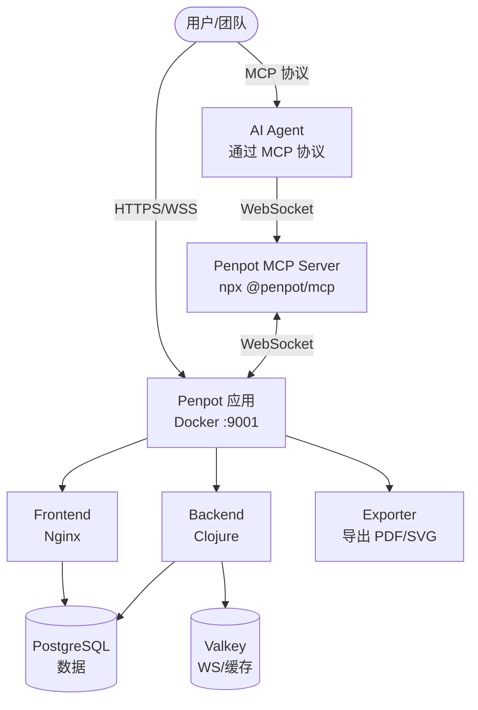

> 调研时间：2026 年 7 月  
> 信源：GitHub 官方仓库、技术博客、官方文档  
> 筛选标准：开源协议 + 可服务器自托管 + 原生/官方 MCP 支持 + Design-to-Code 能力

## 一、结论速览

| 工具 | 开源协议 | 服务器部署 | MCP | D2C | Agent 画原型 | 成熟度 | 推荐度 |
|------|---------|-----------|-----|-----|-------------|--------|--------|
| **Penpot** | MPL 2.0 | ✅ Docker/K8s 官方支持 | ✅ 官方 MCP Server | ✅ 原生 HTML/CSS/JSX | ✅ 读写画布 | ⭐⭐⭐ 生产级 | **首选** |
| **OpenPencil** | MIT | ⚠️ Headless CLI + PWA | ✅ 内置 MCP Server | ✅ JSX/Tailwind | ✅ 100+ AI 工具 | ⭐⭐ 快速发展 | 关注 |
| **Lunacy** | **免费但非开源** | ✅ 私有云/VPS | ✅ 内置本地 MCP | ✅ React/TS | ⚠️ 需桌面端 | ⭐⭐ 成熟 | 备选 |
| Vextra | AGPL-3.0 | ✅ Docker | ✅ MCP | ✅ Vue/TS | ✅ | ⭐ 社区小 | 观察 |

> **核心结论**：当前唯一同时满足「开源 + 服务器部署 + 官方 MCP + 原生 D2C + Agent 驱动」全部条件的工具是 **Penpot**。OpenPencil 是 2026 年值得密切关注的黑马，但服务器部署场景下不如 Penpot 成熟。

## 二、首推方案：Penpot

### 2.1 基本信息

| 属性 | 详情 |
|------|------|
| **官网** | [penpot.app](https://penpot.app) |
| **GitHub** | [github.com/penpot/penpot](https://github.com/penpot/penpot) |
| **Stars** | ~46,900+ |
| **协议** | MPL 2.0（Mozilla Public License） |
| **技术栈** | Clojure/Script + PostgreSQL + Valkey |

### 2.2 服务器部署（官方支持）

Penpot 提供 **官方 Docker Compose 文件** 和 **Kubernetes Helm Chart**：

```bash
# Docker Compose 一键部署
mkdir -p ~/penpot && cd ~/penpot
wget https://raw.githubusercontent.com/penpot/penpot/main/docker/images/docker-compose.yaml
docker compose -p penpot -f docker-compose.yaml up -d
# 默认监听 http://localhost:9001
```

- **最低配置**：1-2 CPU / 4GB RAM / 10GB 磁盘
- **生产配置**：NGINX/Caddy/Traefik 反向代理 + HTTPS + WebSocket 支持
- **备份**：PostgreSQL `pg_dump` + assets volume 定期备份
- **认证**：内置邮箱/LDAP/OIDC（GitHub/GitLab/通用 SSO）

### 2.3 官方 MCP Server

Penpot 官方维护 MCP Server（[github.com/penpot/penpot-mcp](https://github.com/penpot/penpot-mcp)）：

| 特性 | 说明 |
|------|------|
| **架构** | MCP Server ↔ WebSocket ↔ Penpot MCP Plugin（浏览器内） |
| **能力** | Agent 可执行任意 Penpot Plugin API 代码 |
| **传输** | Remote MCP（推荐）、Local `/sse` 回退 |
| **安装** | `npx @penpot/mcp@stable` |

**5 个核心 MCP 工具**：

- `execute_code` — Agent 执行任意 JS 代码操作设计文件
- `high_level_overview` — 获取 API 概览（会话开始时调用一次）
- `penpot_api_info` — 查询 Penpot JS API 文档
- `export_shape` — 导出形状为 PNG/SVG/PDF
- `import_image` — 导入图片资源

### 2.4 原生 D2C（Design-to-Code）

Penpot 基于 **开放 Web 标准**（SVG + CSS + HTML）构建，D2C 是原生能力而非插件：

```javascript
// Agent 通过 MCP 调用 D2C
const html = penpot.generateMarkup(shapes, { type: "html" });
const css = penpot.generateStyle(shapes, {
  type: "css",
  withPrelude: true,
  includeChildren: true
});
```

- **生成 HTML 标记** — 完整语义化结构
- **生成 CSS 样式** — 含 box-sizing reset、子元素样式
- **生成 Font Faces** — 自动提取字体声明
- **设计令牌** — W3C 标准 Design Tokens，直接映射为 CSS 变量

### 2.5 Agent 驱动画原型

通过 MCP，Agent 可以**完全无头（headless）**地操作 Penpot 画布：

```javascript
// Agent 创建画板
const board = penpot.createBoard();
board.name = "Dashboard";
board.resize(1440, 900);

// Agent 添加文本
const heading = penpot.createText("Welcome Back");
heading.fills = [{ fillColor: "#FFFFFF" }];
board.appendChild(heading);

// Agent 应用 Flex 布局
const flex = board.addFlexLayout();
flex.dir = "column";
flex.alignItems = "center";
flex.rowGap = 24;

// Agent 创建组件
const component = penpot.library.local.createComponent([buttonBg, buttonText]);
component.name = "Button/Primary";
```

**社区 Skill 增强**：`ar27111994/penpot-mcp` 提供完整的 Agent 工作流模板：

- 设计系统构建/审计/迁移
- 原型流程（线性/Overlay/Drawer/多流程）
- D2C 工作流（Page→HTML/CSS、Design→React、Token 提取）
- 安全规则（小批量写入、READ→PLAN→WRITE→VERIFY）

### 2.6 部署架构



### 2.7 完整工作流示例

**阶段 1：Agent 通过 MCP 创建原型**

User：帮我设计一个登录页面  
Agent（via MCP）：

1. `createBoard("Login Page", 1440, 900)`
2. `createText("Sign In")` → 设置字体/颜色
3. `createRectangle()` → 输入框背景
4. `addFlexLayout()` → 垂直居中排列
5. `createComponent("Button/Primary")` → 复用组件
6. `addInteraction("click" → "navigate-to: dashboard")`

**阶段 2：D2C 导出代码**

User：把设计转成 React 代码  
Agent（via MCP）：

1. `generateMarkup(shapes, {type: "html"})`
2. `generateStyle(shapes, {type: "css", includeChildren: true})`
3. 结合设计令牌 → 生成 Tailwind/React 组件

**阶段 3：双向同步（可选）**

代码修改后 → Agent 更新 Penpot 画布  
Penpot 设计更新 → Agent 同步代码

## 三、备选方案对比

### 3.1 OpenPencil — AI-Native 开源设计编辑器

| 属性 | 详情 |
|------|------|
| **GitHub** | [github.com/open-pencil/open-pencil](https://github.com/open-pencil/open-pencil) |
| **协议** | MIT |
| **技术栈** | Vue 3 + Skia CanvasKit WASM + Tauri v2 |
| **Stars** | 快速增长中（2026 年活跃开发） |

**核心能力**：

- 原生读写 `.fig`（Figma）和 `.pen` 文件
- 内置 AI Chat（100+ 工具操作画布）
- **MCP Server**（stdio + HTTP）：`@open-pencil/mcp`
- **D2C**：导出 JSX/Tailwind、设计令牌提取
- **Headless CLI**：支持无头操作
- **P2P 协作**：WebRTC 实时协作，无需服务器

**与 Penpot 的关键差异**：

| 维度 | Penpot | OpenPencil |
|------|--------|------------|
| 部署方式 | 服务器 Docker/K8s | 桌面 App（Tauri）+ PWA |
| 服务器成熟度 | ⭐⭐⭐ 生产级 | ⭐⭐ 需配合 CLI |
| 文件格式 | 自有格式 + SVG 导出 | 原生 .fig + .pen |
| MCP 官方性 | 官方维护 | 内置官方 |
| 协作模式 | 服务器中心化 | P2P WebRTC |
| D2C 输出 | HTML/CSS/JSX | JSX/Tailwind |

> **适用场景**：如果你需要**原生读写 Figma 文件** + **轻量级桌面体验**，OpenPencil 是更好的选择；如果你需要**团队级服务器部署** + **完整协作**，Penpot 更合适。

### 3.2 Lunacy — 免费设计工具（非完全开源）

| 属性 | 详情 |
|------|------|
| **官网** | [icons8.com/lunacy](https://icons8.com/lunacy) |
| **作者** | Icons8 |
| **协议** | **免费软件，核心非开源**（插件 API 开源） |
| **私有云** | 支持 VPS/企业私有部署 |

**核心能力**：

- 内置 **MCP Server**（`localhost:31415`）
- **D2C**：React/TypeScript 完整应用生成
- 私有云部署选项

**关键限制**：

- ⚠️ **核心代码不开源**（仅插件 API 和部分工具开源）
- MCP Server 绑定桌面端运行，非独立服务器服务
- 企业级私有云是付费功能

### 3.3 Vextra — 中文社区开源方案

| 属性 | 详情 |
|------|------|
| **GitHub** | [github.com/kcaitech/vextra-quickstart](https://github.com/kcaitech/vextra-quickstart) |
| **协议** | AGPL-3.0 |
| **部署** | Docker Compose 一键部署 |

**核心能力**：

- 支持 Figma(.fig) 和 Sketch(.sketch) 文件
- MCP Server（SSE 传输）
- D2C：Vue + TS 代码生成
- 在线协作编辑器

**风险点**：

- 社区较小，维护活跃度存疑
- AGPL-3.0 协议对商业使用有传染性要求
- 信源主要依赖中文技术博客，英文社区覆盖有限

## 四、横向对比矩阵

| 维度 | **Penpot** | **OpenPencil** | **Lunacy** | **Vextra** |
|------|:----------:|:------------:|:--------:|:--------:|
| **开源协议** | MPL 2.0 ✅ | MIT ✅ | 免费（非开源）⚠️ | AGPL-3.0 ✅ |
| **服务器部署** | Docker/K8s 官方 | Headless CLI | 私有云（付费） | Docker |
| **MCP 官方性** | 官方 ✅ | 内置 ✅ | 内置 ✅ | 社区 ✅ |
| **MCP 传输** | Remote + SSE | Stdio + HTTP | Local HTTP | SSE |
| **D2C 能力** | HTML/CSS/JSX ✅ | JSX/Tailwind ✅ | React/TS ✅ | Vue/TS ✅ |
| **Agent 写画布** | ✅ 完整 | ✅ 100+ 工具 | ⚠️ 需桌面端 | ✅ |
| **设计令牌** | W3C 标准 ✅ | ✅ | ✅ | ❓ |
| **实时协作** | ✅ 服务器 | P2P WebRTC | ✅ | ✅ |
| **文件格式** | 自有 + SVG | .fig + .pen | .free + .sketch | .fig + .sketch |
| **生产就绪** | ✅ 企业级 | ⚠️ 快速发展 | ✅ 成熟 | ⚠️ 社区小 |
| **社区生态** | ⭐⭐⭐ | ⭐⭐ | ⭐⭐⭐ | ⭐ |

## 五、部署指南（Penpot）

### 5.1 快速部署

```bash
# 1. 准备目录
mkdir -p ~/penpot && cd ~/penpot

# 2. 下载官方 compose 文件
wget https://raw.githubusercontent.com/penpot/penpot/main/docker/images/docker-compose.yaml

# 3. 启动（默认最新版）
docker compose -p penpot -f docker-compose.yaml up -d

# 4. 访问
open http://localhost:9001
```

### 5.2 生产配置要点

```yaml
# docker-compose.yaml 关键环境变量
services:
  penpot-frontend:
    environment:
      - PENPOT_PUBLIC_URI=https://design.yourcompany.com
      - PENPOT_FLAGS=enable-registration enable-login-with-password
  
  penpot-backend:
    environment:
      - PENPOT_DATABASE_URI=postgresql://penpot-postgres/penpot
      - PENPOT_REDIS_URI=redis://penpot-valkey/0
      - PENPOT_ASSETS_STORAGE_BACKEND=assets-fs
      - PENPOT_STORAGE_ASSETS_FS_DIRECTORY=/opt/data/assets
```

### 5.3 配置 MCP Server

```bash
# 安装官方 MCP Server
npx @penpot/mcp@stable
```

```json
// 配置 Cursor / Claude Code（~/.cursor/mcp.json 或 ~/.claude/settings.json）
{
  "mcpServers": {
    "penpot": {
      "command": "npx",
      "args": ["@penpot/mcp@stable"],
      "env": {
        "PENPOT_MCP_PLUGIN_URL": "wss://design.yourcompany.com/ws/mcp"
      }
    }
  }
}
```

### 5.4 安装社区 Skill（增强 D2C）

```bash
# 安装 penpot-mcp skill（推荐）
npx skills add ar27111994/penpot-mcp

# 该 Skill 提供：
# - 设计系统工作流（构建/审计/迁移）
# - 原型工作流（流程/Overlay/动画）
# - D2C 工作流（HTML/CSS/React/Token 提取）
# - 安全规则（批量限制、READ→PLAN→WRITE→VERIFY）
```

## 六、选型建议

| 你的需求 | 推荐工具 | 理由 |
|----------|---------|------|
| **企业级部署，数据主权** | Penpot | MPL 2.0 + 官方 Docker/K8s + 成熟生态 |
| **需要 Agent 完全驱动设计→代码闭环** | Penpot | 官方 MCP + D2C + 社区 Skill 完整覆盖 |
| **团队已有 Figma 文件，想迁移到开源** | OpenPencil | 原生读写 .fig，MIT 协议 |
| **不想运维服务器，要轻量桌面工具** | OpenPencil | Tauri 桌面 App + P2P 协作 |
| **预算有限，接受免费闭源** | Lunacy | 成熟稳定，私有云选项 |
| **中文团队，快速验证** | Vextra | Docker 一键部署，中文文档 |

## 模型版本说明

本文涉及的 AI 工具与模型：

- **AI Agent**：Claude Code（用于通过 MCP 驱动 Penpot 画布）
- **设计代理工具**：Penpot MCP Server（`@penpot/mcp`）、OpenPencil MCP（`@open-pencil/mcp`）、Lunacy 内置 MCP

⚠️ **以发布时为准**：上述 Agent / MCP 工具版本迭代较快，本文描述的接口与能力基于 2026 年 7 月的公开文档；实际部署前请以官方仓库最新版本为准。

---

*本调研基于公开可验证信息。Lunacy 核心代码非开源，仅插件 API 和部分工具开源；Vextra 社区较小，生产使用前建议充分评估。*

## 参考来源

[^1]: Penpot Blog "How to deploy Penpot with Docker" — [penpot.app/blog/deploy-penpot-with-docker/](https://penpot.app/blog/deploy-penpot-with-docker/)
[^2]: Penpot Self-Hosting Guide — [help.penpot.app/technical-guide/getting-started/](https://help.penpot.app/technical-guide/getting-started/)
[^3]: GitHub `penpot/penpot-mcp` README — [github.com/penpot/penpot-mcp](https://github.com/penpot/penpot-mcp)
[^4]: GitHub `ar27111994/penpot-mcp` README — [github.com/ar27111994/penpot-mcp](https://github.com/ar27111994/penpot-mcp)
[^5]: GitHub `mrf0xvn/penpot-mcp-guide` — [github.com/mrf0xvn/penpot-mcp-guide](https://github.com/mrf0xvn/penpot-mcp-guide)
[^6]: Penpot AI Workflows — [penpot.app/ai/ai-workflows](https://penpot.app/ai/ai-workflows)
[^7]: Smashing Magazine "Penpot Is Experimenting With MCP Servers" — [smashingmagazine.com](https://www.smashingmagazine.com/)
[^8]: Penpot Community "penpot-mcp skill" — [community.penpot.app](https://community.penpot.app/)
[^9]: GitHub `open-pencil/open-pencil` README — [github.com/open-pencil/open-pencil](https://github.com/open-pencil/open-pencil)
[^10]: Lunacy MCP Documentation — [lunacy.docs.icons8.com/mcp/](https://lunacy.docs.icons8.com/mcp/)
[^11]: feluda.ai "Lunacy MCP Server" — [feluda.ai/mcp-servers/lunacy](https://feluda.ai/mcp-servers/lunacy)
[^12]: 掘金 "Vextra：开源 Figma 的一键部署及使用 MCP 生成代码" — [juejin.cn](https://juejin.cn/post/7540592011154997294)